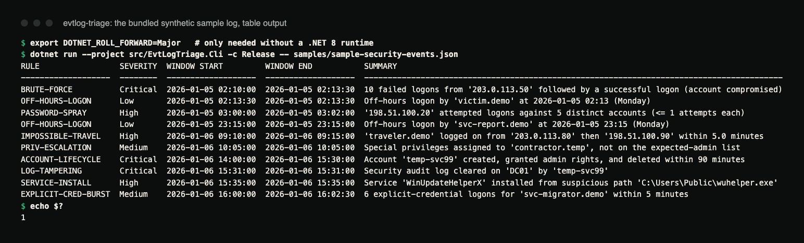

# evtlog-triage

Triage Windows Event Logs for security-relevant **sequences**, not single events.

[](https://github.com/hellpuffyt/evtlog-triage/actions/workflows/ci.yml)
[](LICENSE)

**Status:** working CLI and libraries on .NET 8. The CLI reads JSON and CSV
exports on Linux, macOS and Windows. Reading live channels and `.evtx` files
is a Windows-only library API that has not yet been run against a real
Windows host (see [Platform support](#platform-support)).

## What

`evtlog-triage` reads Windows Security-log events from a JSON or CSV export
(the CLI), or, through the Windows-only library API, from a live channel or an
`.evtx` file. It runs a set of correlation rules over them and produces
findings: a rule ID, severity, time window, the specific events involved, an
explanation of what the pattern means, and a recommended next step.

## Demo

The repository ships a synthetic sample log (33 events, documentation-range IP
addresses, made-up accounts) that triggers every rule:

```console
$ dotnet run --project src/EvtLogTriage.Cli -c Release -- samples/sample-security-events.json
RULE                 SEVERITY  WINDOW START         WINDOW END           SUMMARY
-------------------  --------  -------------------  -------------------  -----------------------------------------------------------------------------------------
BRUTE-FORCE          Critical  2026-01-05 02:10:00  2026-01-05 02:13:30  10 failed logons from '203.0.113.50' followed by a successful logon (account compromised)
OFF-HOURS-LOGON      Low       2026-01-05 02:13:30  2026-01-05 02:13:30  Off-hours logon by 'victim.demo' at 2026-01-05 02:13 (Monday)
PASSWORD-SPRAY       High      2026-01-05 03:00:00  2026-01-05 03:02:00  '198.51.100.20' attempted logons against 5 distinct accounts (<= 1 attempts each)
OFF-HOURS-LOGON      Low       2026-01-05 23:15:00  2026-01-05 23:15:00  Off-hours logon by 'svc-report.demo' at 2026-01-05 23:15 (Monday)
IMPOSSIBLE-TRAVEL    High      2026-01-06 09:10:00  2026-01-06 09:15:00  'traveler.demo' logged on from '203.0.113.80' then '198.51.100.90' within 5.0 minutes
PRIV-ESCALATION      Medium    2026-01-06 10:05:00  2026-01-06 10:05:00  Special privileges assigned to 'contractor.temp', not on the expected-admin list
ACCOUNT-LIFECYCLE    Critical  2026-01-06 14:00:00  2026-01-06 15:30:00  Account 'temp-svc99' created, granted admin rights, and deleted within 90 minutes
LOG-TAMPERING        Critical  2026-01-06 15:31:00  2026-01-06 15:31:00  Security audit log cleared on 'DC01' by 'temp-svc99'
SERVICE-INSTALL      High      2026-01-06 15:35:00  2026-01-06 15:35:00  Service 'WinUpdateHelperX' installed from suspicious path 'C:\Users\Public\wuhelper.exe'
EXPLICIT-CRED-BURST  Medium    2026-01-06 16:00:00  2026-01-06 16:02:30  6 explicit-credential logons for 'svc-migrator.demo' within 5 minutes
$ echo $?
1
```



*Terminal capture of the same run (real output, rendered from the saved
transcript). Exit code 1 means at least one finding is at or above the
default `--fail-on High`.*

The timeline view lists the events behind each finding:

```console
$ dotnet run --project src/EvtLogTriage.Cli -c Release -- samples/sample-security-events.csv --format timeline --rules BRUTE-FORCE,LOG-TAMPERING
[2026-01-05 02:10:00] Critical      BRUTE-FORCE: 10 failed logons from '203.0.113.50' followed by a successful logon (account compromised)
    02:10:00  EventID=4625   Account=victim.demo          Source=203.0.113.50
    02:10:20  EventID=4625   Account=victim.demo          Source=203.0.113.50
    ...       (8 more lines of the same shape, output trimmed)
    02:13:30  EventID=4624   Account=victim.demo          Source=203.0.113.50
[2026-01-06 15:31:00] Critical      LOG-TAMPERING: Security audit log cleared on 'DC01' by 'temp-svc99'
    15:31:00  EventID=1102   Account=temp-svc99           Source=192.0.2.20
```

## Why

A single Event ID 4625 (failed logon) is noise; everyone mistypes a password
sometimes. Ten of them from one source in a few minutes, followed by a 4624
(successful logon), is a brute-force attack that worked, and that is worth
waking someone up for. Most tooling shows you events. This tool looks for the
**patterns across events**, because that is where the signal is.

## Features

- Nine correlation rules covering credential attacks, privilege abuse, account
  lifecycle abuse, log tampering, and persistence.
- Three output formats: a table, JSON (for other tooling), and a
  chronological timeline that lists the events behind each finding.
- Filtering: `--since`, `--severity`, `--rules`/`--exclude`, plus rule context
  (`--expected-admins`, `--business-hours-start`/`--business-hours-end`).
- A configurable exit-code threshold (`--fail-on`) for CI or scheduled jobs.
- The CLI reads flat JSON and CSV exports on any OS. Live channels and `.evtx`
  files can be read on Windows through the
  `EvtLogTriage.Windows.WindowsEventReader` library API; the CLI does not
  expose them.
- Exit codes: `0` no finding at or above `--fail-on`, `1` at least one, `2`
  usage or input error (missing file, malformed JSON/CSV, unknown option,
  invalid value).

## Rules reference

Thresholds are the defaults in `TriageOptions`. Only `--expected-admins` and
the business hours can be changed from the CLI; the rest are library options.

| Rule ID | Severity | Fires on (defaults) | Why it matters |
|---|---|---|---|
| `BRUTE-FORCE` | High (Critical if followed by success) | 10 or more 4625 from one source address (or account, if no address) within 5 minutes | A burst of failures from one source is automated guessing, not user error. If a 4624 follows, the guess worked. |
| `PASSWORD-SPRAY` | High | One source, 5 or more distinct accounts, at most 3 attempts each, within 10 minutes | The inverse shape of brute force. It stays under per-account lockout thresholds, which is why per-account alerting misses it. |
| `OFF-HOURS-LOGON` | Low | 4624 outside business hours (default 08:00 to 18:00) or on a weekend (business days are Monday to Friday) | Not proof of anything by itself, but off-hours activity and attackers in other time zones show up here. Worth a glance, not a page. |
| `PRIV-ESCALATION` | Medium | 4672 for an account not on the expected-admin list | 4672 is routine for real admins; for anyone else it suggests escalation, a group-membership change, or a compromised elevated account. |
| `ACCOUNT-LIFECYCLE` | Critical | 4720 → 4732 → 4726 for the same account within 24 hours | Routine provisioning doesn't delete an account hours after creating it. This is the create-a-throwaway-admin-and-clean-up shape. |
| `LOG-TAMPERING` | Critical | 1102 (audit log cleared) | There is essentially no routine reason to clear the security log. Always reported at the top severity. |
| `SERVICE-INSTALL` | High | 7045 whose `ServiceFileName` (or `ImagePath`) contains `\Temp\`, `\tmp\`, `/tmp/`, `\AppData\Local\Temp`, `\Windows\Temp\`, `\Users\Public\`, `\ProgramData\` or `\Downloads\` (case-insensitive) | Legitimate software installs to Program Files. Malware and lateral-movement tooling installs from writable, unmonitored locations. |
| `EXPLICIT-CRED-BURST` | Medium | 6 or more 4648 for one account (or source) within 5 minutes | A single 4648 is routine (runas, scheduled tasks). A burst suggests scripted credential testing or automated lateral movement. |
| `IMPOSSIBLE-TRAVEL` | High | Same account, 4624 from two distinct source addresses within 15 minutes | **Heuristic only.** It compares source addresses, not geolocation or network distance, so it flags "different address, suspiciously soon", not confirmed impossible travel. Always corroborate before acting. |

Every rule's rationale also lives in its XML doc comment in
`src/EvtLogTriage.Core/Rules/`.

## Architecture

```
src/
  EvtLogTriage.Core/       platform-neutral: EventRecord model, rules, engine, readers (JSON/CSV), output
  EvtLogTriage.Windows/    Windows-only: EVTX / live-channel reader ([SupportedOSPlatform("windows")])
  EvtLogTriage.Cli/        the evtlog-triage executable
tests/
  EvtLogTriage.Core.Tests/ xUnit tests (rules, readers, engine, CLI argument parsing, output)
samples/
  sample-security-events.json / .csv   synthetic sample logs used by the CI smoke test
```

All detection and correlation logic works on the plain `EventRecord` model
(event ID, timestamp, provider, computer, account, source address, level,
structured data fields) and has no dependency on any Windows-only API. That
is what makes it testable and runnable on Linux CI. `EvtLogTriage.Windows` is
a thin, optional adapter that turns a live channel or `.evtx` file into the
same `EventRecord` shape using `System.Diagnostics.Eventing.Reader`.

## Platform support

| Component | Linux / macOS | Windows |
|---|---|---|
| Core detection/correlation engine | Yes | Yes |
| JSON reader | Yes | Yes |
| CSV reader | Yes | Yes |
| CLI (`evtlog-triage`) with JSON/CSV input | Yes | Yes |
| Event XML → `EventRecord` mapping (`EventXmlParser`) | Yes | Yes |
| Live event log channel reader (library API only) | No | Yes (not exercised by the test suite) |
| `.evtx` file reader (library API only) | No | Yes (not exercised by the test suite) |

`EvtLogTriage.Windows` targets `net8.0-windows` and builds on any OS, but its
APIs throw at runtime off Windows, which is why they are gated behind
`[SupportedOSPlatform("windows")]`. If you only have JSON/CSV exports (the
common case for logs pulled off a machine you don't have interactive access
to), everything works cross-platform.

## Installation

Requires the [.NET 8 SDK](https://dotnet.microsoft.com/download/dotnet/8.0)
or newer. The projects target `net8.0`; if only a newer .NET runtime is
installed, set `DOTNET_ROLL_FORWARD=Major` in the environment before running
the tests or the CLI.

```
git clone https://github.com/hellpuffyt/evtlog-triage.git
cd evtlog-triage
dotnet build -c Release
```

## Usage

```
dotnet run --project src/EvtLogTriage.Cli -c Release -- <input-file> [options]
```

or publish the CLI once and run the `evtlog-triage` executable:

```
dotnet publish src/EvtLogTriage.Cli -c Release -o out
./out/evtlog-triage <input-file> [options]      # or: dotnet out/evtlog-triage.dll ...
```

The published executable is framework-dependent. If .NET is installed
somewhere other than the default location (for example through Homebrew),
set `DOTNET_ROOT` or run the `.dll` through `dotnet` instead.

Options:

```
--format <table|json|timeline>   Output format (default: table)
--reader <json|csv>               Force a reader instead of inferring from file extension
--since <ISO-8601 datetime>       Only consider events at or after this time
--severity <level>                Minimum severity to report (default: Informational)
--fail-on <level>                 Exit non-zero if any finding is at/above this severity (default: High)
--rules <RULE1,RULE2,...>         Only run these rule IDs
--exclude <RULE1,RULE2,...>       Skip these rule IDs
--expected-admins <a,b,...>       Accounts allowed to hold admin privileges (default: none)
--business-hours-start <HH:mm>    Business hours start (default: 08:00)
--business-hours-end <HH:mm>      Business hours end (default: 18:00); must be after the start
                                  (overnight business hours are not supported)
--help, -h                        Show help text
```

Severity levels: `Informational`, `Low`, `Medium`, `High`, `Critical`. One
input file per run.

Times: event timestamps and `--since` without an explicit offset are read as
UTC. Business hours are compared against each event's timestamp *as written*
(for `...Z` exports, that is UTC), not against the analyst's or the host's
local time zone.

## Input formats

**JSON**: an array (or single object) of events with *flat* fields. Field
names are matched case-insensitively with several common aliases:

```json
[
  { "EventId": 4625, "TimeCreated": "2026-01-05T02:10:00Z", "Provider": "Microsoft-Windows-Security-Auditing",
    "Computer": "APP-SRV01", "Account": "victim.demo", "SourceAddress": "203.0.113.50", "Level": "Information" }
]
```

Recognized keys: `EventId`/`Id`, `TimeCreated`/`TimeGenerated`,
`Provider`/`ProviderName`/`LogName`, `Computer`/`MachineName`,
`Account`/`TargetUserName`/`SubjectUserName`/`UserId`/`AccountName`,
`SourceAddress`/`IpAddress`/`SourceNetworkAddress`, `Level`/`LevelDisplayName`.
Anything else on the object (e.g. `ServiceFileName`, `ServiceName`) is
preserved and available to rules that need it. A `-` (Windows' "no value") or
blank account/address is treated as missing.

Raw `Get-WinEvent | ConvertTo-Json` output parses (its `Id`, `TimeCreated`,
`ProviderName`, `MachineName` and `LevelDisplayName` are recognized, including
the `/Date(...)/` timestamp form), but it carries the account and source
address only inside the positional `Properties` array and the `Message` text,
which this reader does not decode. With such input the account- and
address-based rules (brute force, spray, impossible travel, privilege
escalation, explicit credentials) cannot fire. Flatten the fields you need
into named properties before exporting.

**CSV**: a header row with the same canonical column names (`EventId`,
`TimeCreated`, `Provider`, `Computer`, `Account`, `SourceAddress`, `Level`),
the shape you get from `Get-WinEvent ... | Select-Object ... | Export-Csv`.
Any extra column is preserved the same way as JSON's extra fields. The
`#TYPE ...` line that Windows PowerShell 5.1's `Export-Csv` writes before the
header is skipped.

**EVTX / live channel** (Windows only, library API): via
`EvtLogTriage.Windows.WindowsEventReader.ReadEvtxFile` or `.ReadChannel`. Each
record's XML rendering is mapped by the platform-neutral `EventXmlParser`,
which takes the account and source address from the *named* `EventData`
fields for each event ID (`TargetUserName`/`IpAddress` for logons,
`SubjectUserName` for 4672 and 1102, `MemberName` or `MemberSid` for 4732).
The mapping is unit-tested on hand-written XML that follows the documented
templates; reading real channels and `.evtx` files has not been verified on a
Windows host. On local groups, 4732 records `MemberName` as `-`, so
`ACCOUNT-LIFECYCLE` can only correlate it with 4720/4726 when the member name
is present.

## Examples

```
# Table output, default thresholds
dotnet run --project src/EvtLogTriage.Cli -c Release -- samples/sample-security-events.json

# JSON output, Critical findings only (pipe it to jq or another tool)
dotnet run --project src/EvtLogTriage.Cli -c Release -- samples/sample-security-events.json \
  --format json --severity Critical

# Timeline view of the CSV sample, only brute-force and log-tampering rules
dotnet run --project src/EvtLogTriage.Cli -c Release -- samples/sample-security-events.csv \
  --format timeline --rules BRUTE-FORCE,LOG-TAMPERING

# Treat an account as an expected admin (removes the sample's PRIV-ESCALATION finding)
dotnet run --project src/EvtLogTriage.Cli -c Release -- samples/sample-security-events.json \
  --expected-admins contractor.temp
```

JSON output is an array of findings, each with `RuleId`, `RuleName`,
`Severity`, `WindowStart`, `WindowEnd`, `Summary`, `Explanation`,
`Recommendation`, `EventIds` and the full `Events`. Apostrophes in strings
are escaped as `\u0027`, which any JSON parser decodes.

## Testing

```
dotnet test
dotnet format --verify-no-changes
```

133 xUnit tests cover every rule firing and *not* firing (including plausible
false-positive shapes: three failed logons is not brute force, an admin on
the expected list using admin privileges is not escalation, a 09:00 logon is
not off-hours), window-boundary behavior, burst merging, the JSON/CSV readers
and the event-XML mapping (including malformed and hostile input), output
formatting, CLI argument parsing, and CLI exit codes.

CI runs the tests on Ubuntu and Windows with .NET 8, a Release build with the
format check, and a smoke test that runs the CLI on both sample files and
checks for the expected findings. The last audit is in
[docs/PRODUCTION_READINESS.md](docs/PRODUCTION_READINESS.md).

## Security

Sample logs in `samples/` use synthetic account names (`victim.demo`,
`temp-svc99`, ...) and IP addresses from the RFC 5737 documentation ranges
(`203.0.113.0/24`, `198.51.100.0/24`, `192.0.2.0/24`). None of it is real
traffic or real identities.

This tool only reads and analyzes logs; it takes no remediation action on its
own. Treat its findings as triage input for a human, not as ground truth. In
particular, `IMPOSSIBLE-TRAVEL` is an address-based heuristic, not a
geolocation check, and false positives are expected for anyone behind a
rotating egress IP or VPN.

To report a vulnerability, see [SECURITY.md](SECURITY.md).

## Contributing

See [CONTRIBUTING.md](CONTRIBUTING.md). Changes are listed in
[CHANGELOG.md](CHANGELOG.md).

## License

MIT, see [LICENSE](LICENSE).
